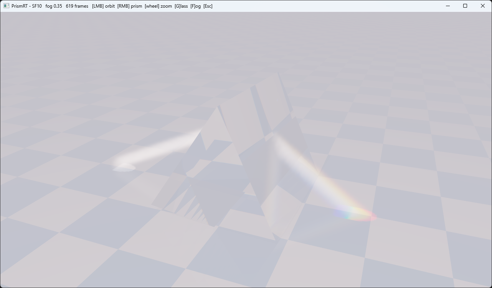

# Spectral Prism

Zero-dependency spectral renderer that shoots a collimated white beam through
a glass prism and disperses it into a continuous rainbow. Three renderers,
one physics core: an offline CPU renderer, a real-time 2D version, and a 3D
Vulkan hardware ray tracer with volumetric fog and photon-mapped caustics.
Native Win32, no external libraries.



| Project | What it is |
|---------|------------|
| `Prism/` | offline CPU light tracer, the reference implementation |
| `PrismLive/` | the same tracer made interactive: drag the prism, watch the fan re-disperse live (CPU trace + OpenGL splat) |
| `PrismRT/` | 3D on `VK_KHR_ray_tracing_pipeline`: deterministic spectral shading, fog, forward photon transport, floor caustic |

## The physics

Dispersion exists because the refractive index `n` depends on wavelength. RGB
rendering gives you three samples and a crude three-way split, not a rainbow.
So light is carried per wavelength (a scalar throughput, not a `vec3`) and
color is assembled through the CIE curves.

- **Sellmeier** dispersion, `n(lambda)`: SF10 heavy flint by default (vivid
  fan), BK7 crown as an alternative (subtler, textbook Newton glass).
- **Exact unpolarized Fresnel** at each interface (not Schlick: the
  approximation shifts color at grazing angles), Snell refraction with total
  internal reflection.
- **CIE 1931** `lambda -> XYZ` via the Wyman/Sloan/Shirley analytic fit (no
  lookup texture), then `XYZ -> linear sRGB -> tonemap -> gamma`.
- **Light travels forward.** Photons go from the source through the prism.
  Before the glass all wavelengths share one path, so the beam is white.
  After refraction `n(lambda)` fans them out, so the fan is a rainbow. This
  direction matters; see the PrismRT section for what happens if you try to
  cheat it.

Beam geometry sits near minimum deviation (~24 deg incidence) so the violet
end, which has the highest index, stays below the critical angle inside the
glass.

## Prism: the offline renderer

Open `Prism.sln` in Visual Studio 2022 (toolset v143), pick **Release / x64**,
build. Requires only the C++ standard library and the Win32 API. No SDK, no
vcpkg, no NuGet. Or from a Developer Command Prompt:

```
cl /std:c++17 /O2 /EHsc Prism\Renderer.cpp Prism\WinMain.cpp /link /SUBSYSTEM:WINDOWS /OUT:Prism.exe
```

| Key | Action |
|-----|--------|
| `R` | re-render |
| `G` | toggle glass (SF10 / BK7) |
| `S` | save `prism.bmp` |
| `Esc` | quit |

| File | Role |
|------|------|
| `Spectral.h` | portable spectral core: Sellmeier, Fresnel, refraction, CIE, sRGB. Shared verbatim by PrismLive, mirrored 1:1 in GLSL by PrismRT. |
| `Renderer.h/.cpp` | scene, light tracing, tone mapping, BMP writer |
| `WinMain.cpp` | Win32 window, background render thread, blit |

Tuning lives in `RenderParams` (`Renderer.h`): `rays`, `exposure`, `beamDeg`,
`useSF10`.

## PrismRT: Vulkan hardware ray tracing

The full 3D application. A beam in vacuum is invisible; a thin isotropic fog
is what makes the white column and the dispersed fan visible in air, like a
laser in smoke. Orbit the camera while it renders, rotate the prism and watch
the caustic sweep across the floor.

### Architecture: deterministic core + forward photon transport

Two ray-trace dispatches per frame share one descriptor set and the same thin
closest-hit and miss shaders (the closest-hit only reports what was hit; all
material logic lives in raygen).

**Photon pass** (`photon.rgen`, 60 x 12 threads). Traces the beam forward
from the aperture: a golden-spiral set of aperture points times 12 spectral
bundles, jittered per frame by golden-ratio sequences. Air segments deposit
XYZ energy into a 3D fog grid; photons landing on the floor deposit into a
2D caustic map. Fixed-point atomics, accumulated across frames, cleared on
accumulation reset.

**Camera pass** (`prism.rgen`). Deterministic Whitted-style spectral
shading, no Monte Carlo:

- a fixed rotating set of 6 wavelengths per frame instead of a random hero
  wavelength (golden-ratio shift per frame converges to the continuous
  spectrum without chroma noise);
- Fresnel evaluated as weights on both branches instead of a stochastic
  pick: the achromatic walker follows the mirror branch, spectral
  transmission chains follow refraction per wavelength, TIR reflects with
  weight 1;
- interleaved-gradient-noise dither instead of white noise for anti-aliasing
  and the fog march;
- the fog march samples the photon grid: zero rays per step.

A single frame is essentially converged. High-frequency noise on the test
scene: ~78 with the Monte Carlo prototype after 90 frames, ~0.5 with the
deterministic renderer after 1 frame.

### Why forward transport, or how the first version lied

The obvious way to light the fog is next event estimation: from each fog
point, trace a connection ray toward the source, refracting through the
prism on the way. The prototype did exactly that, and its validation metric
showed colored samples in the fan region. Both were wrong.

A numerical probe told the truth: 97 fog points across the fan, wavelength
scan 405..695 nm in 5 nm steps, zero successful connections. The geometry
kills them. Forward, light enters the prism at ~54 deg and exits at ~70 deg.
A backward connection ray travels along the beam axis, enters the exit face
nearly head-on and meets the entry face at 54 deg internal, far above SF10's
35.3 deg critical angle. Total internal reflection, every time. The true
arriving direction at a fan point differs from the beam axis by the full
deviation angle, about 50 deg, so no tolerance cone fixes it. This is the
classic caustic problem: the connection direction through a refractive
boundary is unknown. The "rainbow" the prototype showed was chromatic Monte
Carlo noise fooling a saturation metric.

Tracing photons the way the light actually travels solves it exactly, and
two things fall out for free: a real rainbow caustic on the checkerboard
(violet lands closer to the prism because SF10 bends short wavelengths
harder), and comb-shaped TIR patterns when the prism is rotated so part of
the beam bounces internally between face pairs before escaping.

### Scene and shading notes

- Sky gradient with a sun disk, glossy checkerboard floor: Schlick
  reflections as a deterministic mirror branch, sun shadows pass straight
  through the glass with fixed attenuation (the usual trick for light glass
  shadows).
- The beam source is emissive geometry, a quad in the TLAS, not a
  miss-shader light: rays must be able to hit it in front of the floor
  behind it. A purely directional light would light the whole fog volume
  uniformly and no beam would be visible.
- Non-dispersive materials are shaded in precomputed integrated XYZ;
  spectral chains run only through the glass. Flat white integrates to
  `CIE_Y_INTEGRAL`, which keeps the resolve normalization neutral.
- The caustic irradiance is ~1e4 above the display range (the beam intensity
  is tuned for fog inscatter, where it is multiplied by
  `sigma * phase * dt`). A hue-preserving soft knee on the max XYZ component
  compresses it; a luminance knee is not enough, because near the spectral
  locus violet has near-zero Y with huge X and Z, and the channels clip into
  magenta, a color a rainbow cannot contain.
- Tonemap is ACES (Narkowicz fit).

### Files

| File | Role |
|------|------|
| `PrismRT.cpp` | the host, single C++23 file, zero dependencies: `vulkan-1.dll` loaded at runtime, nothing links against the SDK. Win32 window (per-monitor DPI aware), device pick, swapchain, three BLAS (prism, floor, source quad), TLAS rebuilt per frame, two RT pipelines with their own SBTs, resolve compute, blit. Single frame in flight. |
| `layout.h` | the numbers host and shaders must agree on, in one place: descriptor bindings, TLAS instance ids, photon launch size, fog-grid and caustic-map dimensions, floor height. Included by `PrismRT.cpp` and `common.glsl`. |
| `spectral.glsl` | GLSL mirror of `Spectral.h`, identical coefficients |
| `common.glsl` | thin payload, scene UBO, photon-grid layout, shared scene constants |
| `photon.rgen` | forward photon pass |
| `prism.rgen` | camera pass |
| `prism.rchit` / `prism.rmiss` | thin hit reporter / miss marker |
| `resolve.comp` | average, exposure, XYZ to sRGB, ACES, gamma |
| `compile_shaders.bat` | GLSL to SPIR-V via `glslc` (Vulkan SDK) |

Requirements: a GPU with `VK_KHR_ray_tracing_pipeline` (NVIDIA RTX, AMD
RX 6000+, Intel Arc) and the Vulkan SDK at build time for `glslc` and the
headers. Open `PrismRT.vcxproj` in Visual Studio 2022 (toolset v143,
`/std:c++latest`), pick **Release / x64**, build; a pre-build step runs
`compile_shaders.bat`. On a HiDPI display the window opens at the same
apparent size and renders every physical pixel; the title bar shows the
frame time.

Controls: **LMB** orbit camera, **wheel** zoom, **RMB** rotate prism (dx:
twist, dy: incidence angle), **G** SF10/BK7, **F** fog density, **+/-**
exposure, **R** reset accumulation, **Esc** quit.

## PrismLive: real-time 2D

The same light tracer made interactive: drag the prism through a fixed white
beam and watch the fan re-disperse live. Win32 + OpenGL 3.3 core (functions
loaded via `wglGetProcAddress`), still zero dependencies, system
`opengl32.lib` only.

The split: the CPU traces a batch of photon paths per frame (~40k; tracing
is cheap, the offline renderer's cost was splatting, not intersection math)
and emits XYZ-colored line segments; the GPU draws them with additive
blending into an `RGBA32F` MSAA accumulator, then a fullscreen pass
normalizes, adds the glass silhouette, converts XYZ to sRGB, tonemaps and
gammas. Any scene change resets the accumulator: while dragging you see a
live single-batch image, on release it converges in well under a second.
`Spectral.h` is shared with the offline renderer verbatim.

| Input | Action |
|-------|--------|
| LMB drag | move prism |
| mouse wheel | rotate prism |
| RMB drag | tilt the beam |
| `G` | toggle glass (SF10 / BK7) |
| `+` / `-` | exposure |
| `S` | save `prismlive.bmp` |
| `R` | reset accumulation |
| `Esc` | quit |

## Verification

The shaders pass `glslangValidator --target-env vulkan1.2`. The host
cross-compiles cleanly for Windows under Clang with
`-std=c++23 -Wall -Wextra -Wshadow`. The camera and transform math is
unit-tested. The full shader logic exists as a CPU
emulation that renders the identical algorithm to an image, which is how the
broken backward connections were found and the forward transport was proven
before a single line of GLSL was written.

## License

MIT License

Copyright (c) 2026 Mykhailo Makarov

Permission is hereby granted, free of charge, to any person obtaining a copy
of this software and associated documentation files (the "Software"), to deal
in the Software without restriction, including without limitation the rights
to use, copy, modify, merge, publish, distribute, sublicense, and/or sell
copies of the Software, and to permit persons to whom the Software is
furnished to do so, subject to the following conditions:

The above copyright notice and this permission notice shall be included in all
copies or substantial portions of the Software.

THE SOFTWARE IS PROVIDED "AS IS", WITHOUT WARRANTY OF ANY KIND, EXPRESS OR
IMPLIED, INCLUDING BUT NOT LIMITED TO THE WARRANTIES OF MERCHANTABILITY,
FITNESS FOR A PARTICULAR PURPOSE AND NONINFRINGEMENT. IN NO EVENT SHALL THE
AUTHORS OR COPYRIGHT HOLDERS BE LIABLE FOR ANY CLAIM, DAMAGES OR OTHER
LIABILITY, WHETHER IN AN ACTION OF CONTRACT, TORT OR OTHERWISE, ARISING FROM,
OUT OF OR IN CONNECTION WITH THE SOFTWARE OR THE USE OR OTHER DEALINGS IN THE
SOFTWARE.

## Support

If you found this project interesting or useful, you can support my work:

[](https://github.com/sponsors/makarov-mm)
